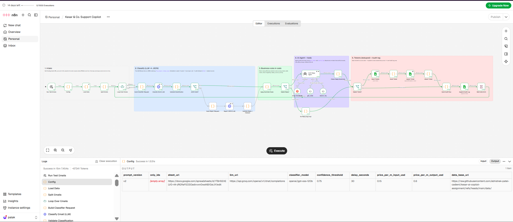
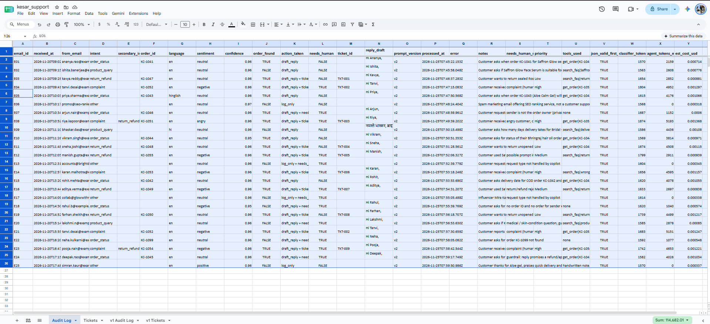
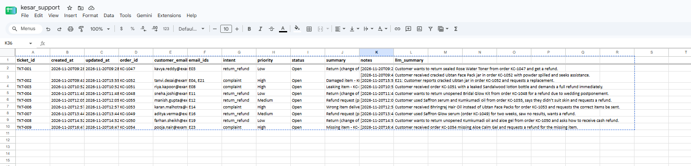

# Kesar & Co. Support Copilot — Palak

**Google Sheet (Audit Log + Tickets):** https://docs.google.com/spreadsheets/d/1TBriSEXELV0-44-jRGRaFEO3Oadivvxn0waNB10aIJY/edit
**Video walkthrough:**

## 1. Summary

- **What I built:** an n8n workflow that reads each customer email, classifies it with an LLM into the required JSON, looks up the order, applies the return/refund policy in code, has an AI Agent (with `get_order` and `search_faq` tools) draft a reply, checks the draft with code guardrails, creates or updates a ticket, and logs every email to Google Sheets.
- **Platform and LLM:** n8n Cloud + Groq `openai/gpt-oss-120b` (classifier at temperature 0 with JSON mode; agent at temperature 0.3). Google Sheets for the audit log and tickets.
- **Time spent:** ~8 hours (a large part on LLM provider issues, see section 5).
- **Results (v2, all 25 emails):** intent 25/25, correct action 23/25, valid JSON on first try 25/25. Failures are documented in [TEST_REPORT.md](TEST_REPORT.md).
- **What doesn't work yet:** E19 (COD refund draft asks for bank details too early) and E24 (correct reply over-escalated). Fixes are written and unit-tested but were not re-run end to end.

## 2. Architecture

| Step / node | What it does | Why I designed it this way |
|---|---|---|
| Config | One place for prompt version (v1/v2), subset of emails, sheet URL, model, threshold, delay | Easy to rerun v1 vs v2 and test subsets without touching logic |
| Load Data / Split / Loop | Fetches orders.json, faq.md and the 25 emails from the repo, processes one email at a time | One at a time so ticket dedupe sees earlier tickets, and to stay inside free-tier rate limits |
| Build Classifier Request → Classify Email (LLM) | Sends the email (fenced as untrusted data) with the classification prompt | JSON mode + temperature 0 for reliable structured output |
| Validate Classification → JSON Valid? → Repair → Fallback | Validates against `llm_output.schema.json` in code; if invalid, one repair call showing the model its error; if still invalid, falls back to `other` + needs human | The flow never crashes on bad output and never guesses |
| Apply Business Rules (code) | Order lookup (ID from regex, else sender email), privacy check, days since delivery, return/damage eligibility, needs_human, ticket priority | Hard rules live in code, not prompts, so an email can't talk the system out of them |
| Draft Reply Agent + `get_order` + `search_faq` | Agent decides which tools to call and drafts a reply in the brand voice | `get_order` only returns orders owned by the sender; `search_faq` returns whole FAQ sections so answers stay grounded |
| Check Reply Guardrails (code) | Flags drafts with amounts/links/order IDs not in the data, privacy leaks, medical claims, refund promises the policy didn't approve | A second, deterministic safety net after the LLM |
| Needs Ticket? → Read Tickets → Build Ticket → Upsert Ticket | For returns/complaints: if an open ticket exists for the same order, update it (add email ID + note), else create one | No duplicate tickets (E04 + E21 → one ticket) |
| Build Audit Row → Append Audit Log → Wait | One row per email with all template columns + reason, tools used, tokens, cost | Full traceability; the wait respects rate limits |

### Results in the sheet

| v2 Audit Log (all 25 emails) | v2 Tickets (E04 + E21 share TKT-002) |
|---|---|
|  |  |

v1 baseline (10 emails): [audit log](./screenshots/v1_audit_log.png), [tickets](./screenshots/v1_tickets.png).

## 3. Setup — how someone else can run this

1. **Accounts:** n8n (Cloud trial or self-hosted), a Groq API key (console.groq.com), a Google account.
2. **Sheet:** create a Google Sheet with tabs **Audit Log** and **Tickets**, using the headers in `sheets/audit_log.csv` and `sheets/tickets.csv`.
3. **Import:** in n8n, Create Workflow → ⋯ → Import from File → `workflow/kesar_support_copilot.json`.
4. **Credentials** (stored in n8n, never in the file): a Groq credential on *Classify Email (LLM)*, *Repair JSON (LLM)* and *Groq Chat Model*; a Google Sheets OAuth credential on *Read Tickets*, *Upsert Ticket* and *Append Audit Log*.
5. **Config node:** paste your sheet URL; set `prompt_version` (`v1`/`v2`) and `only_ids` (`[]` = all 25).
6. **Run:** click Execute. Each email takes ~35 s (30 s delay for the Groq free tier).

Source of truth for the logic is `code/` and `prompts/`; `python tools/build_workflow.py` regenerates the workflow JSON.

## 4. Prompts

- Classifier v1 (baseline): [prompts/classifier_v1.md](prompts/classifier_v1.md) — default temperature, no JSON mode.
- Classifier v2 (final): [prompts/classifier_v2.md](prompts/classifier_v2.md) + the JSON contract in `code/lib_schema.js` — temperature 0, `response_format: json_object`.
- Agent system prompt: [prompts/agent_system.md](prompts/agent_system.md) — temperature 0.3, max 6 iterations. The per-email "case brief" is built in `code/08_apply_business_rules.js`.

## 5. Key decisions and assumptions

- **Low confidence:** below **0.75** goes to needs_human. In testing, clear emails scored 0.95+, so 0.75 only catches genuinely vague emails (like E18 "Where is it???") without flooding the team.
- **needs_human also triggers on:** every complaint, rejected returns, angry sentiment, privacy mismatch, medical questions, possible prompt injection, unknown orders, and any guardrail flag.
- **Duplicate tickets:** before creating one, read the Tickets tab and look for a non-Closed ticket with the same order ID. If found, update that row (append the email ID and a dated note, keep the higher priority).
- **Order details only to the owner:** the sender email must equal the order's `customer_email`. This is checked in code and again inside the `get_order` tool, and the guardrail checks the draft doesn't leak the tracking link or address (E07).
- **Grounding in the FAQ:** policy and product facts come only from `search_faq`. If nothing matches, the agent must tag the reply `[NEEDS_HUMAN]`. Amounts and links in drafts are checked against the FAQ and the order.
- **Dates:** all date maths use the email's `received_at` (IST) and the order's dates, in code, never in the LLM.
- **"other" emails** get no reply (log only); non-spam ones that need action (e.g. GST invoice) are flagged needs_human.
- **LLM provider:** I started with Gemini 3.8 Flash on the AI Studio free tier. All 53 requests failed (429/503), so I switched to Groq. Groq had retired `llama-3.3-70b-versatile`, so I chose `openai/gpt-oss-120b` from the models available on my key.

## 6. Scaling to 1,000 emails/day

- **Breaks first:** LLM rate limits (the free tier allowed ~2 emails/min) and the Google Sheets API (reading the whole Tickets tab per email gets slow and hits quotas).
- **Changes:** a paid LLM tier with a queue (n8n queue mode / workers) instead of a fixed wait; move tickets and the audit log to a real database (Postgres) with an index on order_id; use the store's real order API.
- **Reliability:** retries with exponential backoff, a dead-letter list for emails that fail twice, alerts when the fallback rate or needs_human rate spikes.
- **Monitoring:** a daily dashboard of intent mix, needs_human %, guardrail flags, cost per email.

## 7. Product-thinking questions

1. **Auto-send vs. draft:** Auto-send only order-status replies and FAQ product answers where confidence ≥ 0.9, the order belongs to the sender, and no guardrail fired. Everything involving money (refunds, replacements), complaints, angry customers, medical or privacy cases stays a draft for a human. I'd start even stricter (everything drafted) for two weeks, measure how often agents send drafts unedited per category, and only then open auto-send for the categories that are consistently right.

2. **Cost:** Measured in v2: ~1,650 classifier tokens + ~3,250 agent tokens (estimated) ≈ 4,900 tokens/email, ~3,700 input / ~1,200 output. At Groq gpt-oss-120b prices ($0.15/M input, $0.60/M output): 3,700 × 0.15/1M + 1,200 × 0.60/1M ≈ $0.0013, about ₹0.11 per email. 1,000 emails/day × 30 days = 30,000 emails → ~$39/month (~₹3,300). Even at 5× that, it's far cheaper than one extra support hire.

3. **Success metric:** The **% of drafts sent without edits** (by category). It directly measures whether the copilot saves the agent time. I'd switch it off (back to manual) if any reply shared order details with the wrong person, promised a refund that policy doesn't allow, or gave medical advice. One such incident matters more than the time saved.

4. **Failure experience:** Most failures are safe by design: an unsure or risky case becomes a draft for a human, so the customer just waits up to 24 business hours. The bad case is a wrong auto-sent reply (e.g. a wrong date). To limit damage: auto-send only low-risk categories, use only facts from the order data, log every draft for audit, and follow up quickly with a correction and an apology when a human spots an error.

5. **Don't automate:** **Refund and replacement approval**, especially for damage claims. It needs a human to look at the photos, judge if the claim is genuine, and decide on goodwill gestures for upset customers like E08. Mistakes cost real money and trust, and the volume is low enough that a human can handle it.

## 8. How I used AI tools

I used **Claude (Claude Code)** heavily, and want to be clear about it:
- **Claude** read the assignment repo with me, proposed the architecture, wrote the n8n workflow JSON, all the Code-node JavaScript, the prompts, the sheet templates, and drafted this README and the test report. It also wrote an offline test harness to check the logic against all 25 emails before I ran it in n8n.
- **I** set up the accounts and credentials (n8n Cloud, Google Sheets, Gemini, then Groq), ran every test in n8n, pasted the real results back, and made the calls when things broke: switching from Gemini to Groq after the free tier failed, choosing gpt-oss-120b, cleaning up the duplicate-row bug, choosing to compare v1 and v2 on the hardest 10 emails, and deciding to submit with two documented failures instead of hiding them.

## 9. If I had one more week

- Re-run all 25 with the E19/E24 fixes and add a small regression test set that runs on every change.
- An LLM-as-judge check that every claim in a draft is supported by the FAQ sections retrieved.
- Real token usage for the agent (via the provider) instead of estimates.
- Move the ticket store to a database and add a simple review UI for needs_human drafts.
